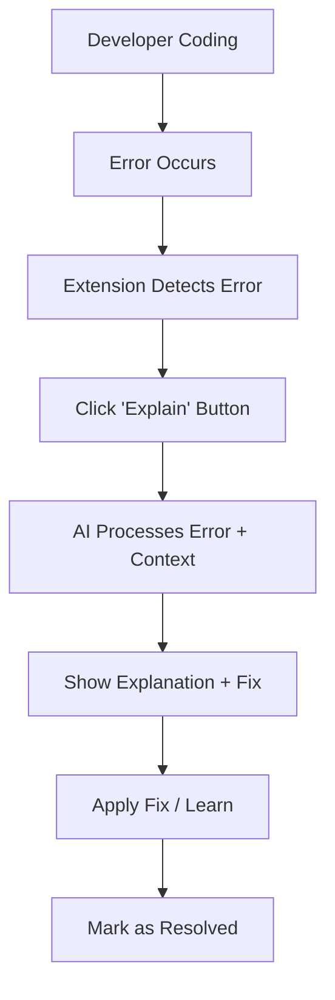

# Product Context: Explain This Error

## Why This Project Exists

### The Developer Pain Point
Every developer has experienced this frustrating cycle:
1. Code breaks with cryptic error message
2. Copy-paste error into Google
3. Scroll through StackOverflow, GitHub issues, documentation
4. Try multiple solutions that don't work
5. Finally find the fix 10-30 minutes later
6. Forget the solution by next time

### The Cost of Error Research
- **Individual:** 15-20% of coding time spent on error research
- **Team:** Knowledge silos - same errors researched repeatedly
- **Business:** Delayed features, frustrated developers, context switching

### Market Opportunity
- 25+ million developers worldwide
- Growing complexity of modern web development
- AI revolution enabling better developer tools
- Existing solutions are fragmented and context-poor

## Problems We Solve

### 1. Immediate Error Understanding
**Current State:** Cryptic error messages require research
**Our Solution:** Plain English explanations with context

**Example:**
```
Error: Cannot read property 'map' of undefined
↓ AI Explanation ↓
"You're trying to use .map() on a variable that is undefined. This usually happens when:
1. An API call hasn't finished loading yet
2. The data structure isn't what you expected
3. A prop wasn't passed correctly to a component"
```

### 2. Contextual Fix Suggestions
**Current State:** Generic StackOverflow answers
**Our Solution:** Context-aware fixes based on your specific error

### 3. Real-time Monitoring
**Current State:** Developers miss errors, especially in production
**Our Solution:** Proactive error detection with instant notifications

### 4. Knowledge Retention
**Current State:** Developers re-research the same errors
**Our Solution:** Personal/team error history and learning

## How It Should Work

### User Experience Flow


### Core Interactions

#### 1. Error Detection
- **Automatic:** Extension monitors DevTools console/network
- **Manual:** Developer can paste any error for explanation
- **Proactive:** Catches errors before developer notices

#### 2. Explanation Request
- **One-Click:** Simple "Explain" button next to each error
- **Batch:** Select multiple errors for explanation
- **Quick:** <3 second response time

#### 3. Understanding Phase
- **Plain English:** No technical jargon
- **Visual:** Code snippets with highlights
- **Progressive:** Basic → Advanced explanations available

#### 4. Resolution Phase
- **Copy-Paste:** Ready-to-use code fixes
- **Multiple Options:** Different approaches explained
- **Verification:** Check if fix actually works

### User Experience Goals

#### Accessibility
- Works for junior → senior developers
- No learning curve required
- Keyboard shortcuts for power users

#### Speed
- Faster than Google search
- No context switching required
- Instant error classification

#### Learning
- Developers understand root causes
- Build mental models for future debugging
- Reduce dependency on external resources

#### Integration
- Seamless DevTools integration
- No disruption to existing workflow
- Works with any JavaScript framework

## Success Scenarios

### Scenario 1: Junior Developer
**Situation:** React component breaking with "Cannot read property" error
**Current Experience:** 20 minutes of StackOverflow research
**With Our Tool:** 
1. Error appears in console
2. Click "Explain" → "This happens when props aren't passed correctly"
3. See fix: "Add PropTypes or check parent component"
4. Apply fix in 2 minutes

### Scenario 2: Senior Developer
**Situation:** Complex async/await error in production
**Current Experience:** Deep debugging, log analysis
**With Our Tool:**
1. Error caught in real-time
2. AI explains: "Race condition in async operations"
3. See pattern: "Use Promise.allSettled() instead of Promise.all()"
4. Quick fix with confidence

### Scenario 3: Development Team
**Situation:** Same API error affecting multiple developers
**Current Experience:** Each developer researches independently
**With Our Tool:**
1. First developer gets explanation
2. Solution shared automatically with team
3. Future occurrences instantly resolved
4. Team knowledge base grows

## Product Philosophy

### Developer-First Design
- Built by developers who understand the pain
- No marketing fluff, pure utility
- Respect for developer time and workflow

### AI as Amplifier
- AI enhances human understanding
- Never replaces developer judgment
- Transparent about confidence levels

### Privacy & Trust
- Minimal data collection
- Local storage when possible
- Clear data usage policies

### Continuous Learning
- AI gets smarter with usage
- Community-driven improvements
- Regular model updates

