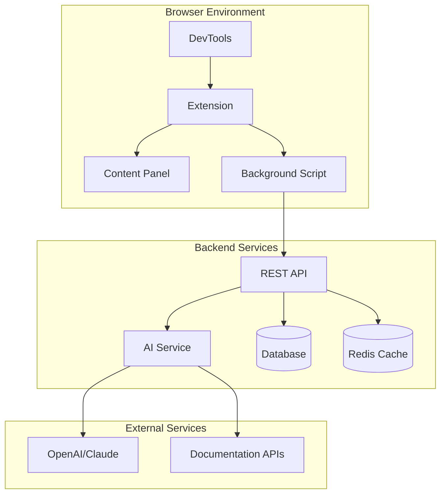

# System Patterns: Explain This Error

## Overall Architecture

### High-Level System Design


### Component Relationships

#### Browser Extension Layer
- **Content Script** → **DevTools Integration** → **Error Detection**
- **Background Script** → **API Communication** → **State Management**
- **Popup/Panel UI** → **User Interface** → **Error Presentation**

#### Backend Service Layer
- **API Gateway** → **Request Routing** → **Response Formatting**
- **AI Service** → **Error Processing** → **Explanation Generation**
- **Data Layer** → **Caching** → **Persistence**

## Key Technical Decisions

### 1. Extension Architecture Pattern
**Decision:** Manifest V3 with Service Worker
**Reasoning:**
- Future-proof (Manifest V2 deprecated)
- Better security model
- Required for Chrome Web Store approval
- Background script persistence handling

**Implementation:**
```javascript
// manifest.json
{
  "manifest_version": 3,
  "background": {
    "service_worker": "background.js"
  },
  "content_scripts": [{
    "matches": ["<all_urls>"],
    "js": ["content.js"]
  }]
}
```

### 2. DevTools Integration Pattern
**Decision:** Devtools Panel + Content Script Injection
**Reasoning:**
- Access to console API
- Real-time error monitoring
- Seamless user experience
- No performance impact on web pages

**Implementation:**
```javascript
// DevTools panel creation
chrome.devtools.panels.create(
  "Error Explain",
  "icon.png",
  "panel.html"
);

// Console monitoring
chrome.devtools.network.onRequestFinished.addListener(handleNetworkError);
```

### 3. Error Data Structure Pattern
**Decision:** Standardized Error Context Object
**Reasoning:**
- Consistent AI input format
- Extensible for future error types
- Clear separation of concerns

**Schema:**
```typescript
interface ErrorContext {
  type: 'console' | 'network' | 'manual';
  timestamp: number;
  error: {
    message: string;
    stack?: string;
    line?: number;
    column?: number;
    filename?: string;
  };
  context: {
    url: string;
    userAgent: string;
    framework?: string;
    networkInfo?: NetworkError;
  };
  metadata: {
    severity: 'error' | 'warning' | 'info';
    frequency: number;
    resolved: boolean;
  };
}
```

### 4. AI Integration Pattern
**Decision:** Context-Aware Prompt Engineering
**Reasoning:**
- Better explanation quality
- Framework-specific advice
- Relevant fix suggestions

**Prompt Structure:**
```typescript
interface AIPrompt {
  systemPrompt: string;  // Role definition
  contextPrompt: string; // Error details + environment
  outputFormat: string;  // JSON schema for response
}
```

### 5. Caching Strategy Pattern
**Decision:** Multi-Layer Caching
**Reasoning:**
- Reduce AI API costs
- Faster response times
- Better user experience

**Layers:**
1. **Browser Cache:** Extension local storage (common errors)
2. **Server Cache:** Redis (recent explanations)
3. **AI Cache:** Static database (known error patterns)

## Design Patterns in Use

### 1. Observer Pattern - Error Detection
```typescript
class ErrorMonitor {
  private observers: ErrorObserver[] = [];
  
  subscribe(observer: ErrorObserver) {
    this.observers.push(observer);
  }
  
  private notifyObservers(error: ErrorContext) {
    this.observers.forEach(observer => observer.handle(error));
  }
}
```

### 2. Strategy Pattern - AI Processing
```typescript
interface ExplanationStrategy {
  canHandle(error: ErrorContext): boolean;
  explain(error: ErrorContext): Promise<Explanation>;
}

class AIExplanationService {
  private strategies: ExplanationStrategy[] = [
    new ConsoleErrorStrategy(),
    new NetworkErrorStrategy(),
    new ReactErrorStrategy()
  ];
}
```

### 3. Factory Pattern - Error Parsers
```typescript
class ErrorParserFactory {
  static create(type: ErrorType): ErrorParser {
    switch(type) {
      case 'console': return new ConsoleErrorParser();
      case 'network': return new NetworkErrorParser();
      case 'react': return new ReactErrorParser();
    }
  }
}
```

### 4. Command Pattern - User Actions
```typescript
interface Command {
  execute(): Promise<void>;
  undo(): Promise<void>;
}

class ExplainErrorCommand implements Command {
  constructor(private error: ErrorContext) {}
  
  async execute() {
    const explanation = await aiService.explain(this.error);
    ui.showExplanation(explanation);
  }
}
```

## Security Patterns

### 1. Content Security Policy
```json
{
  "content_security_policy": {
    "extension_pages": "script-src 'self'; object-src 'self'"
  }
}
```

### 2. Permission Minimization
```json
{
  "permissions": [
    "devtools",
    "storage",
    "activeTab"
  ],
  "host_permissions": [
    "https://api.explainthiserror.com/*"
  ]
}
```

### 3. Data Sanitization
```typescript
class ErrorSanitizer {
  static sanitize(error: ErrorContext): ErrorContext {
    return {
      ...error,
      error: {
        ...error.error,
        stack: this.removePersonalInfo(error.error.stack)
      }
    };
  }
}
```

## Performance Patterns

### 1. Lazy Loading
```typescript
// Load AI service only when needed
const aiService = lazy(() => import('./services/aiService'));
```

### 2. Debouncing
```typescript
// Prevent API spam on rapid errors
const debouncedExplain = debounce(explainError, 300);
```

### 3. Batching
```typescript
// Batch multiple similar errors
class ErrorBatcher {
  private batch: ErrorContext[] = [];
  
  add(error: ErrorContext) {
    this.batch.push(error);
    if (this.batch.length >= 5) {
      this.processBatch();
    }
  }
}
```

## Error Handling Patterns

### 1. Graceful Degradation
```typescript
class ExplanationService {
  async explain(error: ErrorContext): Promise<Explanation> {
    try {
      return await this.aiExplain(error);
    } catch (aiError) {
      return await this.fallbackExplain(error);
    }
  }
}
```

### 2. Circuit Breaker
```typescript
class AIServiceClient {
  private failures = 0;
  private isOpen = false;
  
  async call(prompt: string) {
    if (this.isOpen) {
      throw new Error('Circuit breaker open');
    }
    // ... implementation
  }
}
```

### 3. Retry Logic
```typescript
async function withRetry<T>(
  fn: () => Promise<T>,
  maxRetries: number = 3
): Promise<T> {
  for (let i = 0; i < maxRetries; i++) {
    try {
      return await fn();
    } catch (error) {
      if (i === maxRetries - 1) throw error;
      await delay(1000 * Math.pow(2, i));
    }
  }
}
```

## Data Flow Patterns

### 1. Unidirectional Data Flow
```
Error Detected → Parsed → Enriched → Explained → Presented → Resolved
```

### 2. Event-Driven Architecture
```typescript
class EventBus {
  emit(event: string, data: any) {
    this.listeners[event]?.forEach(callback => callback(data));
  }
}

// Usage
eventBus.emit('error:detected', errorContext);
eventBus.emit('explanation:received', explanation);
```

### 3. State Management
```typescript
interface AppState {
  errors: ErrorContext[];
  explanations: Map<string, Explanation>;
  filters: FilterState;
  history: HistoryState;
}

class StateManager {
  private state: AppState;
  private subscribers: ((state: AppState) => void)[] = [];
}
```

